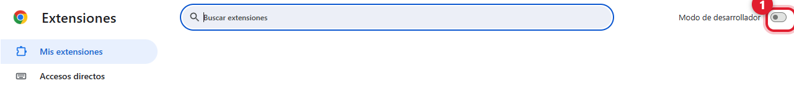
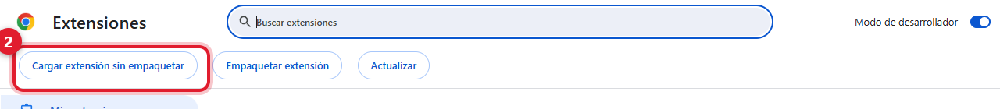
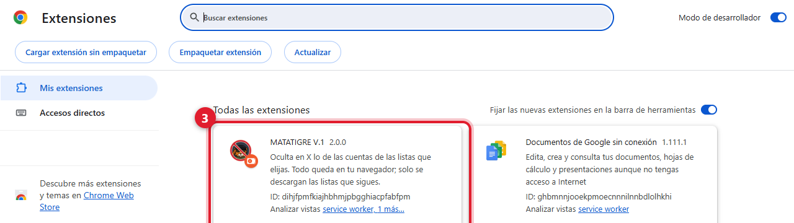
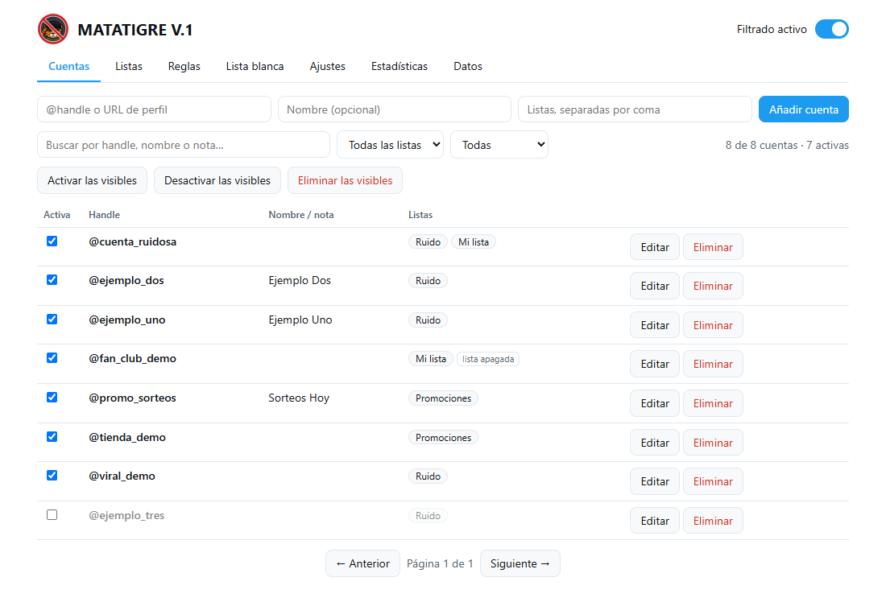

  

<h1 align="center">MATATIGRE V.1</h1>

  Extensión de Chrome que oculta en X las publicaciones de las cuentas que elijas.

  
  
  

  <a href="#instalación">Instalación</a> ·
  <a href="#primeros-pasos">Primeros pasos</a> ·
  <a href="#configuración">Configuración</a> ·
  <a href="#cómo-funciona">Cómo funciona</a> ·
  <a href="docs/USO.md">Manual</a> ·
  <a href="DISCLAIMER.md">Descargo de responsabilidad</a>

  

> Úsala bajo tu propia responsabilidad. Es un proyecto independiente y no tiene relación con X Corp.
> Antes de instalarla, lee el [descargo de responsabilidad](DISCLAIMER.md).

## Qué hace

MATATIGRE cambia lo que tu navegador muestra de X. Tú eliges las cuentas que no quieres ver y la extensión oculta sus
publicaciones, los reposts que hacen y las citas a sus posts. Si lo activas, también oculta las respuestas dirigidas a esas
cuentas y las menciones.

Funciona en tu navegador: no usa servidores, no recopila datos y no tiene dependencias. La configuración se guarda en el
propio Chrome.

Incluye una lista inicial de 204 cuentas públicas repartidas en cinco listas (ver [docs/LISTAS.md](docs/LISTAS.md)). Puedes
apagar cualquiera de ellas, editarlas o reemplazarlas por la tuya.

## Instalación

Hace falta Chrome 111 o superior. También funciona en Edge, Brave y otros navegadores basados en Chromium. Como no está en
la Chrome Web Store, se instala como extensión sin empaquetar. Son unos minutos.

**1. Descarga y descomprime.** En [Releases](https://github.com/LarexDev/matatigre/releases) descarga `matatigre-v1.2.0.zip` y
descomprímelo en una carpeta que no vayas a borrar (por ejemplo `Documentos\matatigre`), porque Chrome la carga desde ahí.
Si prefieres el código fuente, clona el repositorio con `git clone https://github.com/LarexDev/matatigre.git` y usa la carpeta `extension`.

**2. Activa el modo de desarrollador.** Abre `chrome://extensions` y enciende el interruptor de la esquina superior derecha.

**3. Carga la extensión.** Pulsa *Cargar extensión sin empaquetar* (en inglés, *Load unpacked*) y elige la carpeta que contiene
el archivo `manifest.json`.

**4. Comprueba la instalación.** Debe aparecer la tarjeta *MATATIGRE V.1* con el interruptor encendido.

**5. Abre [x.com](https://x.com) y recarga con F5.** Para tener el icono a mano, fíjalo desde el icono del puzzle de la barra de Chrome.

La guía completa, con la actualización, la desinstalación y los problemas más comunes, está en [docs/INSTALACION.md](docs/INSTALACION.md).

## Primeros pasos

1. Pulsa el icono del tigre. Cuando X haya cargado contenido, el popup dirá "Lectura de la API de X activa".
2. Para añadir una cuenta, escribe su `@usuario` (o pega la URL de su perfil) y pulsa *Añadir*. También puedes abrir el perfil
   y usar el botón *Añadir @usuario (perfil abierto)*.
3. Vuelve a tu Inicio: sus publicaciones ya no deberían aparecer.
4. Elige el modo (ocultar, colapsar o resaltar) y marca qué más debe contar: citas, reposts, respuestas o menciones.
5. En *Ocultadas recientemente* puedes ver qué se filtró y por qué, lo que ayuda a detectar errores.
6. *Gestionar lista y reglas* abre la página de opciones.

La lista inicial se hizo a partir de información pública y puede tener errores, así que conviene revisarla en
*Opciones → Cuentas*. Las listas de Petro, Petristas y Antipetristas vienen apagadas; se encienden en *Opciones → Listas*.
Si eres titular de una cuenta incluida y quieres que se corrija o se retire, abre un
[issue](https://github.com/LarexDev/matatigre/issues/new/choose).

 

## Configuración

| Qué | Opciones |
| --- | --- |
| Modo | Ocultar (se quita antes de mostrarse), colapsar (queda una barra con el motivo y un clic la abre) o resaltar (se ve, pero marcada). |
| Qué cuenta como coincidencia | El autor siempre. Opcionalmente los reposts, las citas, las respuestas, las menciones y las sugerencias de cuentas. |
| Reglas | Sobre el usuario, el nombre, la biografía, el texto y el idioma, con comodín (`bot_*`), "contiene" o expresión regular. Hay un probador. |
| Dónde se filtra | Un interruptor por sección: Inicio, Búsqueda, Perfiles, Publicación abierta e hilos, Listas, Notificaciones, Guardados y otras. |
| Excepciones | Lista blanca; no filtrar dentro del perfil de la propia cuenta; no ocultar la publicación que abres directamente. |
| Listas | Agrupan cuentas por etiqueta y se encienden o apagan enteras. |
| Estadísticas | Total, por motivo, por día y cuentas más filtradas. |
| Copia de seguridad | Exportar e importar en JSON, con validación. |
| Atajos | `Alt+Shift+M` pausa o reanuda; `Alt+Shift+H` alterna entre ocultar y resaltar. Se pueden cambiar en `chrome://extensions/shortcuts`. |

Por defecto se filtran el autor, los reposts y las citas; las respuestas y las menciones quedan apagadas para no ocultar de más.
El manual completo está en [docs/USO.md](docs/USO.md). Las capturas usan cuentas ficticias.

Más capturas: reglas, ajustes y estadísticas

## Cómo funciona

X cambia su interfaz con frecuencia, y su código actual ya ni siquiera usa `data-testid`. Por eso la extensión usa dos
mecanismos que no dependen del diseño de la página.

El primero intercepta las respuestas que X recibe de su API para mostrar el timeline. En cada publicación identifica al autor,
quien la repostea, la cuenta citada, la respuesta y las menciones, y quita de la respuesta las que coinciden con tu lista antes
de que lleguen a la pantalla. El segundo lee cada publicación en la página a partir de sus enlaces (`/usuario/status/ID`) y sirve de
respaldo; es también el que aplica los modos colapsar y resaltar.

Los detalles técnicos están en [docs/DESARROLLO.md](docs/DESARROLLO.md).

## Limitaciones

- X puede cambiar su sitio o su API en cualquier momento y dejar la extensión sin funcionar, total o parcialmente. Si algo se
  cuela, usa *Copiar diagnóstico* en el popup y abre un [issue](https://github.com/LarexDev/matatigre/issues/new/choose).
- Los cambios de configuración se aplican a lo que X cargue desde ese momento. Para que valgan para todo, recarga la pestaña.
- Una lista de usuarios no sigue a las personas: si una cuenta cambia de nombre de usuario, deja de coincidir.
- No filtra mensajes directos ni contenido que sea solo imagen. Tampoco silencia ni bloquea en X: solo cambia lo que ve tu navegador.
- Las reglas de texto, nombre y biografía pueden ocultar de más. Conviene probarlas antes con el probador.
- Se probó con pruebas automáticas y con la estructura de X que se puede ver sin iniciar sesión. Con sesión iniciada puede haber diferencias.

## Documentación

| Documento | Contenido |
| --- | --- |
| [docs/INSTALACION.md](docs/INSTALACION.md) | Instalación paso a paso, actualización, desinstalación y problemas comunes |
| [docs/USO.md](docs/USO.md) | Manual de uso |
| [docs/LISTAS.md](docs/LISTAS.md) | La lista inicial y el formato de las listas |
| [docs/DESARROLLO.md](docs/DESARROLLO.md) | Arquitectura, pruebas, empaquetado y publicación |
| [PRIVACY.md](PRIVACY.md) | Qué datos guarda la extensión y qué permisos usa |
| [DISCLAIMER.md](DISCLAIMER.md) | Descargo de responsabilidad |
| [CHANGELOG.md](CHANGELOG.md) | Historial de versiones |
| [CONTRIBUTING.md](CONTRIBUTING.md) y [SECURITY.md](SECURITY.md) | Cómo contribuir y cómo reportar vulnerabilidades |

## Licencia y aviso legal

El software se ofrece tal cual, sin garantía de ningún tipo. El autor no se hace responsable del uso que se le dé ni de sus
consecuencias, entre ellas posibles restricciones de tu cuenta por parte de X, contenido que no se oculte o que se oculte por
error, o cualquier otro daño. El uso es bajo tu propia responsabilidad. El texto completo está en [DISCLAIMER.md](DISCLAIMER.md)
y la licencia es [MIT](LICENSE).

"X" y "Twitter" son marcas de sus titulares. Este proyecto es independiente y no está afiliado, patrocinado ni respaldado por X Corp.
