

  

<h1 align="center">MATATIGRE V.1</h1>

  Extensión de Chrome que oculta en X las publicaciones de las cuentas que elijas.

  
  
  

  <a href="#instalación">Instalación</a> ·
  <a href="#primeros-pasos">Primeros pasos</a> ·
  <a href="#configuración">Configuración</a> ·
  <a href="#cómo-funciona">Cómo funciona</a> ·
  <a href="docs/USO.md">Manual</a> ·
  <a href="DISCLAIMER.md">Descargo de responsabilidad</a>

  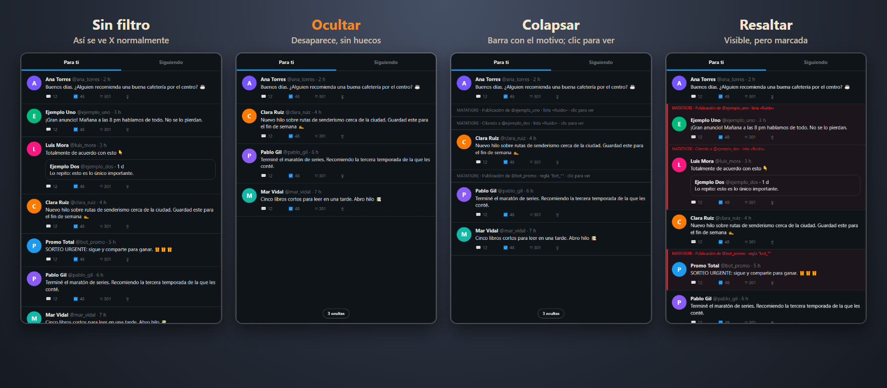

> Úsala bajo tu propia responsabilidad. Es un proyecto independiente y no tiene relación con X Corp.
> Antes de instalarla, lee el [descargo de responsabilidad](DISCLAIMER.md).

## Qué hace

MATATIGRE cambia lo que tu navegador muestra de X. Tú eliges las cuentas que no quieres ver y la extensión oculta sus
publicaciones, los reposts que hacen y las citas a sus posts. Si lo activas, también oculta las respuestas dirigidas a esas
cuentas y las menciones.

Funciona en tu navegador: no usa servidores propios, no recopila datos y no descarga ningún código: todo va dentro de la extensión. La configuración se guarda en el
propio Chrome.

La extensión no trae cuentas incluidas. Te suscribes a **listas** que se descargan de un [repositorio de datos aparte](https://github.com/LarexDev/matatigre-listas)
y se actualizan solas cada 12 horas, así que no hace falta reinstalarla cuando una lista cambia. Al abrirla por primera vez, una pantalla de
bienvenida te muestra las listas disponibles. También puedes crear tus propias cuentas, o suscribirte a una lista publicada por otra persona
con su URL (ver [docs/LISTAS.md](docs/LISTAS.md)).

## Instalación

Hace falta Chrome 111 o superior. También funciona en Edge, Brave y otros navegadores basados en Chromium. Como no está en
la Chrome Web Store, se instala como extensión sin empaquetar. Son unos minutos.

**1. Descarga y descomprime.** En [Releases](https://github.com/LarexDev/matatigre/releases) descarga `matatigre-v2.0.0.zip` y
descomprímelo en una carpeta que no vayas a borrar (por ejemplo `Documentos\matatigre`), porque Chrome la carga desde ahí.
Si prefieres el código fuente, clona el repositorio con `git clone https://github.com/LarexDev/matatigre.git` y usa la carpeta `extension`.

**2. Activa el modo de desarrollador.** Abre `chrome://extensions` y enciende el interruptor de la esquina superior derecha.

**3. Carga la extensión.** Pulsa *Cargar extensión sin empaquetar* (en inglés, *Load unpacked*) y elige la carpeta que contiene
el archivo `manifest.json`.

**4. Comprueba la instalación.** Debe aparecer la tarjeta *MATATIGRE V.1* con el interruptor encendido.

**5. Elige tus listas.** Al instalar se abre una pantalla de bienvenida con las listas disponibles. Marca las que quieras y pulsa
*Empezar*.

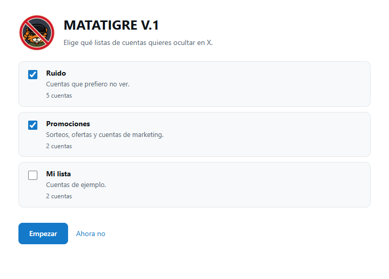

**6. Abre [x.com](https://x.com) y recarga con F5.** Para tener el icono a mano, fíjalo desde el icono del puzzle de la barra de Chrome.

La guía completa, con la actualización, la desinstalación y los problemas más comunes, está en [docs/INSTALACION.md](docs/INSTALACION.md).

## Primeros pasos

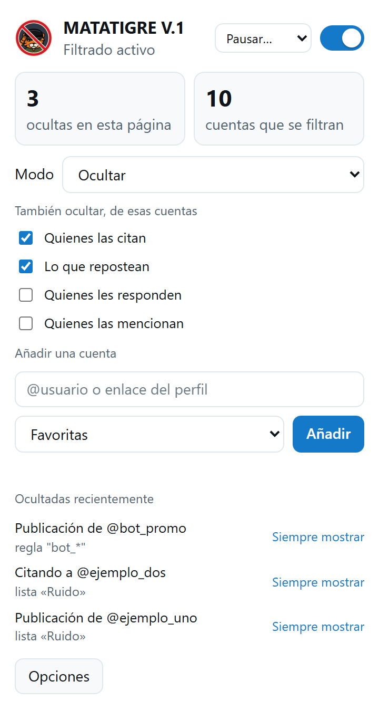

1. Pulsa el icono del tigre. Cuando X haya cargado contenido, el popup dirá "Lectura de la API de X activa".
2. Para añadir una cuenta, escribe su `@usuario` (o pega la URL de su perfil) y pulsa *Añadir*. También puedes abrir el perfil
   y usar el botón *Añadir @usuario*, o pasar el ratón sobre cualquier publicación en X y pulsar el icono de MATATIGRE que aparece en la esquina de la publicación: elige una lista (o crea una nueva) y listo, con *Deshacer*.
3. Vuelve a tu Inicio: sus publicaciones ya no deberían aparecer.
4. Elige el modo (ocultar, colapsar o resaltar) y marca qué más debe contar: citas, reposts, respuestas o menciones.
5. En *Ocultadas recientemente* puedes ver qué se filtró y por qué, lo que ayuda a detectar errores.
6. *Opciones* abre la página de configuración.

Revisa las listas en *Opciones → Listas*: cada lista se enciende o apaga entera y, en las sincronizadas (solo lectura), cualquier cuenta se puede omitir solo para ti. Si eres titular de una cuenta incluida y quieres que se corrija o se retire, abre un
[issue en el repositorio de listas](https://github.com/LarexDev/matatigre-listas/issues/new/choose).

 

## Configuración

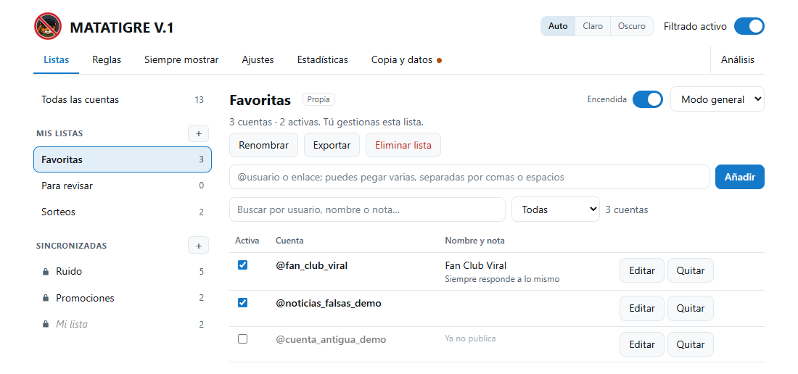

| Qué | Opciones |
| --- | --- |
| Modo | Ocultar (se quita antes de mostrarse), colapsar (queda una barra con el motivo y un clic la abre) o resaltar (se ve, pero marcada). Hay un modo general y cada lista puede tener el suyo; si hay conflicto, gana el más restrictivo. Un contador discreto indica cuántas publicaciones se ocultaron en la vista. |
| Qué cuenta como coincidencia | El autor siempre. Opcionalmente los reposts, las citas, las respuestas, las menciones y las sugerencias de cuentas. |
| Reglas | Sobre el usuario, el nombre, la biografía, el texto y el idioma, con comodín (`bot_*`), "contiene" o expresión regular. Hay un probador. |
| En qué partes de X | Un interruptor por sección: Inicio, Búsqueda, Perfiles, Publicación abierta e hilos, Listas, Notificaciones, Guardados y otras. |
| Cuándo no ocultar | «Siempre mostrar» (pestaña aparte: cuentas que nunca se ocultan); no ocultar dentro del perfil de la propia cuenta ni la publicación que abres directamente. |
| Listas | Te suscribes a listas del catálogo o de una URL propia; se actualizan solas y se encienden o apagan enteras. Tus cuentas propias van aparte y no se tocan. |
| Modo analista | Apagado por defecto. Al activarlo en *Ajustes* aparece la pestaña *Análisis* y se enciende el registro. Quien no lo necesita no ve nada de esto. |
| Análisis | Con el modo analista, toma tus listas como punto de partida y reconstruye la red a su alrededor: quién interactúa con quién (también las cuentas externas que las responden, citan o amplifican), qué comunidades forman, qué cuentas son relevantes y cómo se originan y propagan las narrativas. Cada hallazgo muestra las cuentas, las publicaciones de evidencia y los criterios; la sincronía se contrasta con un modelo de azar y se controlan los falsos descubrimientos. Mapa de relaciones interactivo, expedientes con evidencia anclada, informe e integridad verificable. |
| Estadísticas | Total, por motivo, por día y cuentas más filtradas. |
| Registro local | Solo con el modo analista (apagado por defecto): guarda en tu equipo lo que publican las cuentas de tus listas y lo que otras cuentas les responden, citan, repostean o mencionan, para analizarlo. No sale de tu navegador. |
| Copia de seguridad | Exportar e importar en JSON, con validación. |
| Atajos | `Alt+Shift+M` pausa o reanuda; `Alt+Shift+H` alterna entre ocultar y resaltar. Se pueden cambiar en `chrome://extensions/shortcuts`. |

Por defecto se filtran el autor, los reposts y las citas; las respuestas y las menciones quedan apagadas para no ocultar de más.
El manual completo está en [docs/USO.md](docs/USO.md). Las capturas usan cuentas ficticias.

Más capturas: listas, análisis, reglas, ajustes y estadísticas

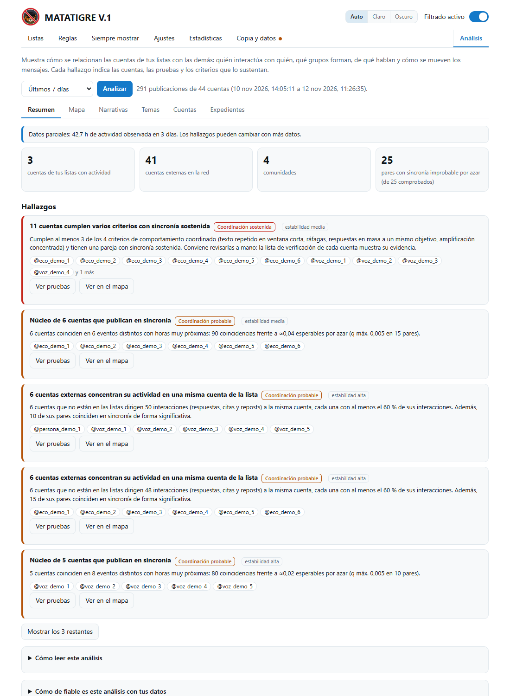

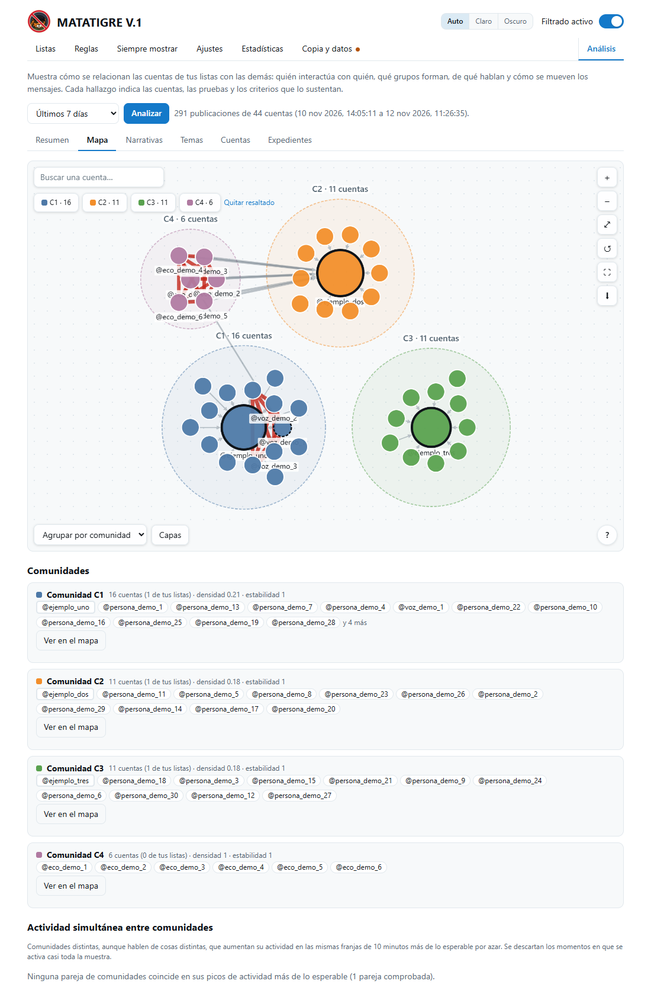

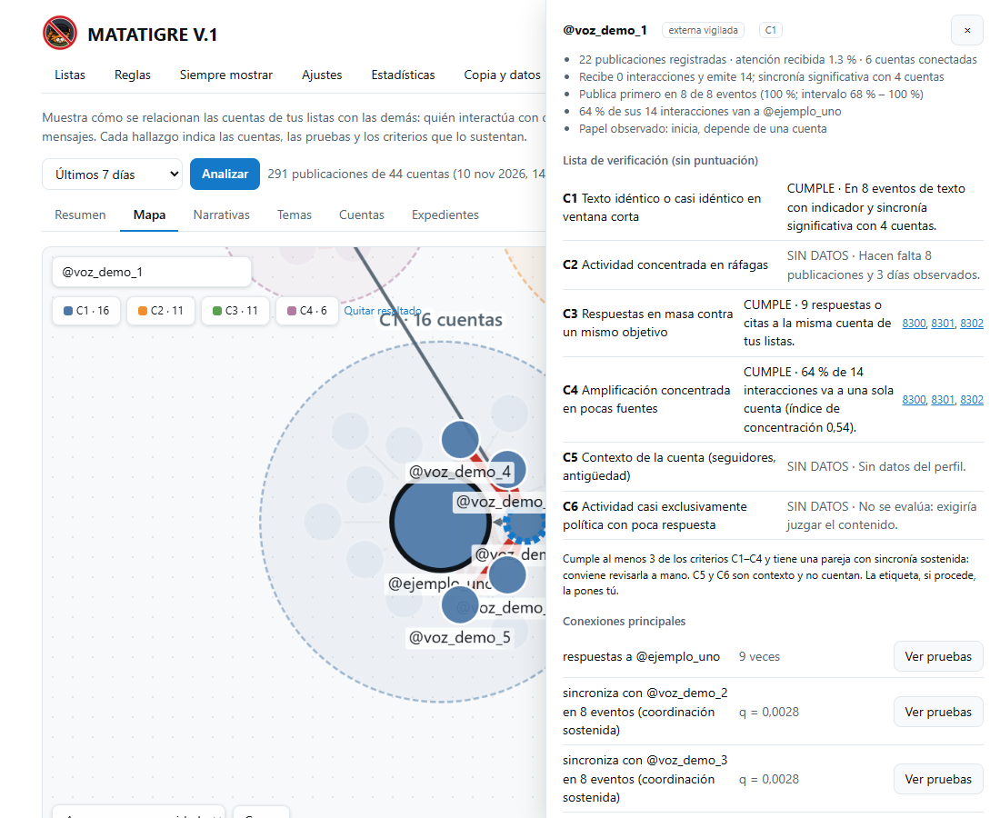

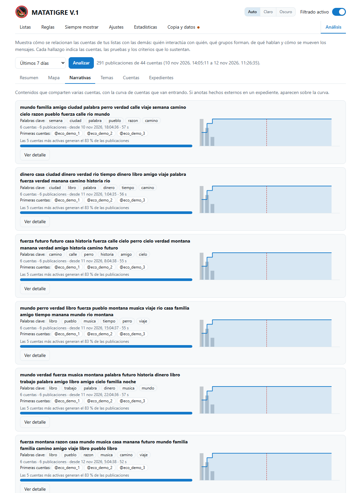

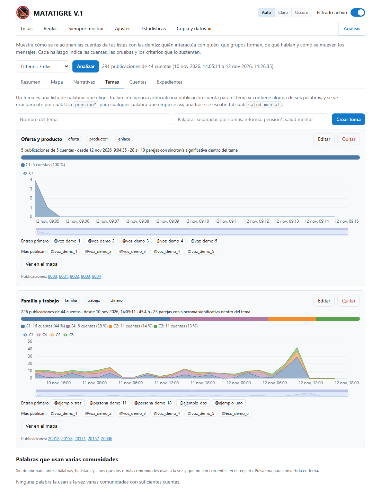

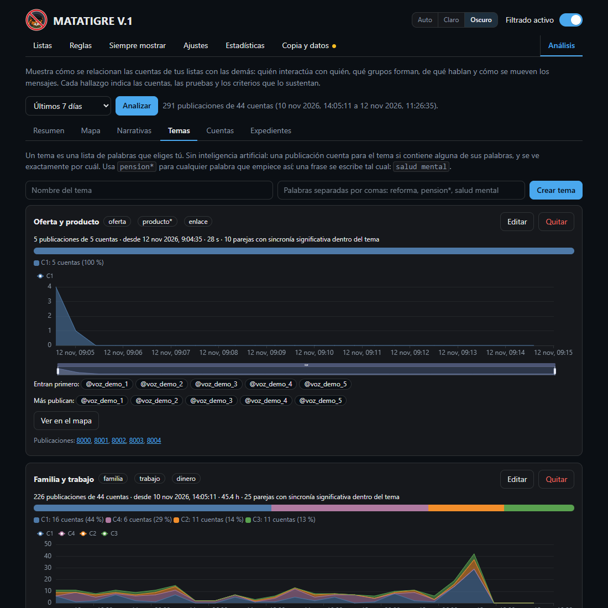

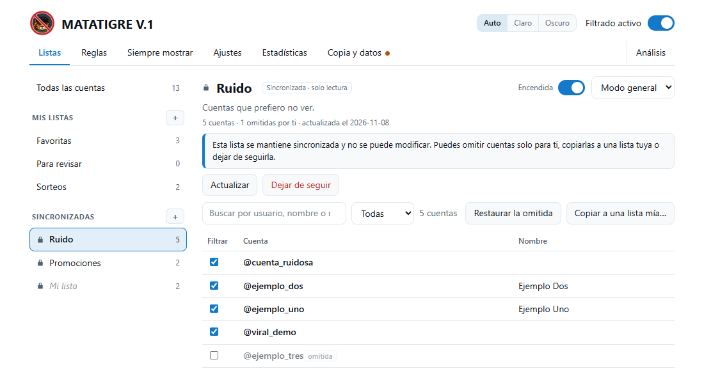

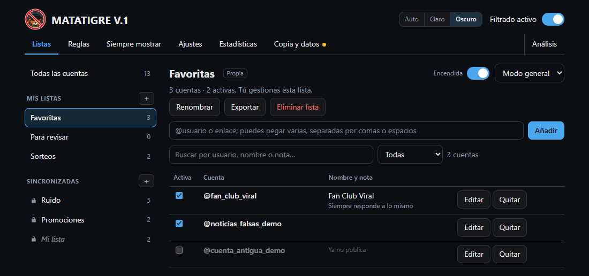

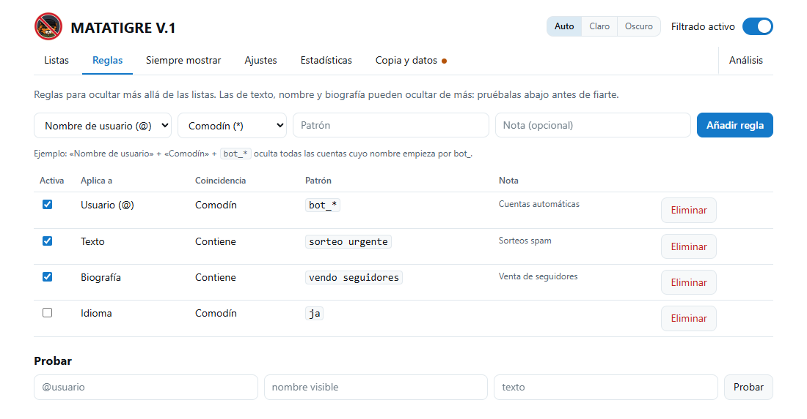

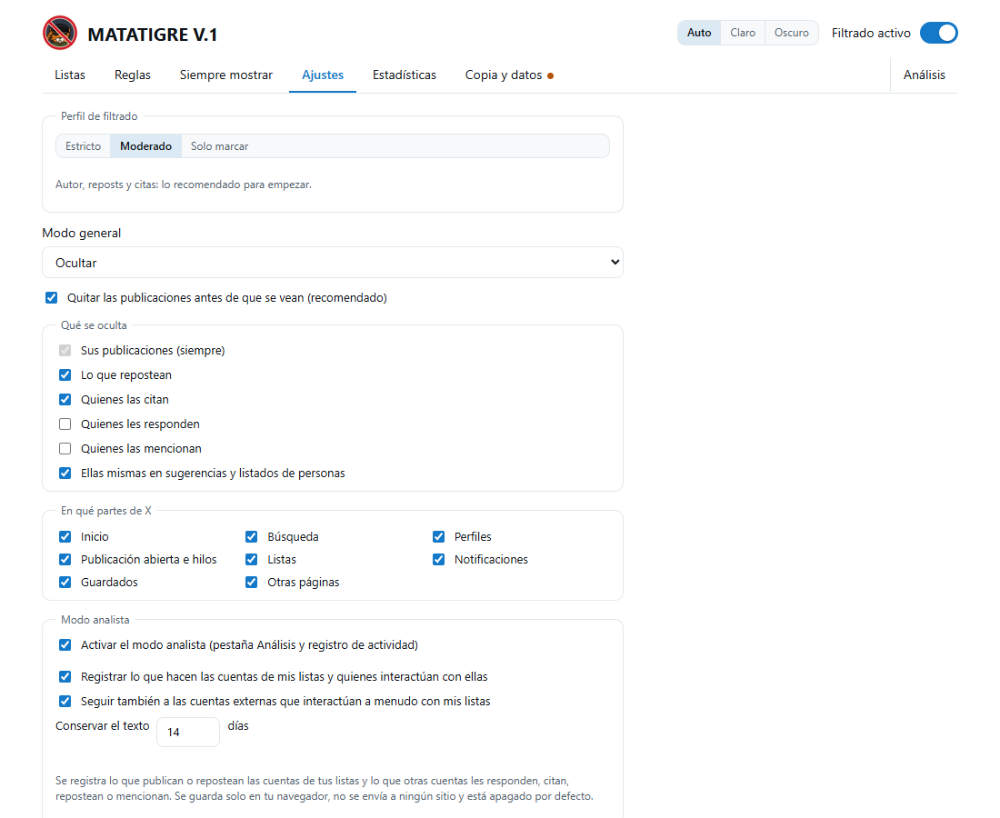

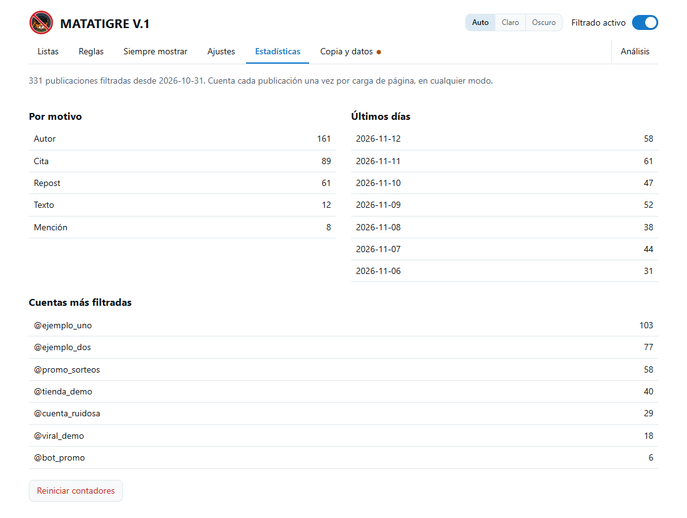

## Cómo funciona

X cambia su interfaz con frecuencia, y su código actual ya ni siquiera usa `data-testid`. Por eso la extensión usa dos
mecanismos que no dependen del diseño de la página.

El primero intercepta las respuestas que X recibe de su API para mostrar el timeline. En cada publicación identifica al autor,
quien la repostea, la cuenta citada, la respuesta y las menciones, y quita de la respuesta las que coinciden con tu lista antes
de que lleguen a la pantalla. El segundo lee cada publicación en la página a partir de sus enlaces (`/usuario/status/ID`) y sirve de
respaldo; es también el que aplica los modos colapsar y resaltar.

Los detalles técnicos están en [docs/DESARROLLO.md](docs/DESARROLLO.md).

## Limitaciones

- X puede cambiar su sitio o su API en cualquier momento y dejar la extensión sin funcionar, total o parcialmente. Si algo se
  cuela, usa *Opciones → Copia y datos → Copiar informe para soporte* y abre un [issue](https://github.com/LarexDev/matatigre/issues/new/choose).
- Los cambios de configuración se aplican a lo que X cargue desde ese momento. Para que valgan para todo, recarga la pestaña.
- Una lista de usuarios no sigue a las personas: si una cuenta cambia de nombre de usuario, deja de coincidir.
- Las listas se descargan de GitHub. Si no hay conexión o el servidor falla, la extensión sigue con la última copia que descargó.
- No filtra mensajes directos ni contenido que sea solo imagen. Tampoco silencia ni bloquea en X: solo cambia lo que ve tu navegador.
- Las reglas de texto, nombre y biografía pueden ocultar de más. Conviene probarlas antes con el probador.
- Se probó con pruebas automáticas y con la estructura de X que se puede ver sin iniciar sesión. Con sesión iniciada puede haber diferencias.

## Documentación

| Documento | Contenido |
| --- | --- |
| [docs/INSTALACION.md](docs/INSTALACION.md) | Instalación paso a paso, actualización, desinstalación y problemas comunes |
| [docs/USO.md](docs/USO.md) | Manual de uso |
| [docs/LISTAS.md](docs/LISTAS.md) | Listas suscribibles, cómo publicar una propia y el formato de importación |
| [Repositorio de listas](https://github.com/LarexDev/matatigre-listas) | El catálogo y las listas, con el formato y cómo pedir una corrección o un retiro |
| [docs/DESARROLLO.md](docs/DESARROLLO.md) | Arquitectura, pruebas, empaquetado y publicación |
| [PRIVACY.md](PRIVACY.md) | Qué datos guarda la extensión y qué permisos usa |
| [DISCLAIMER.md](DISCLAIMER.md) | Descargo de responsabilidad |
| [CHANGELOG.md](CHANGELOG.md) | Historial de versiones |
| [CONTRIBUTING.md](CONTRIBUTING.md) y [SECURITY.md](SECURITY.md) | Cómo contribuir y cómo reportar vulnerabilidades |

## Licencia y aviso legal

El software se ofrece tal cual, sin garantía de ningún tipo. El autor no se hace responsable del uso que se le dé ni de sus
consecuencias, entre ellas posibles restricciones de tu cuenta por parte de X, contenido que no se oculte o que se oculte por
error, o cualquier otro daño. El uso es bajo tu propia responsabilidad. El texto completo está en [DISCLAIMER.md](DISCLAIMER.md)
y la licencia es [MIT](LICENSE).

"X" y "Twitter" son marcas de sus titulares. Este proyecto es independiente y no está afiliado, patrocinado ni respaldado por X Corp.
