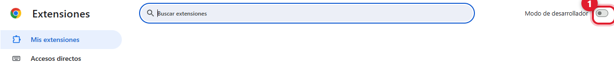
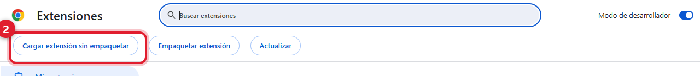
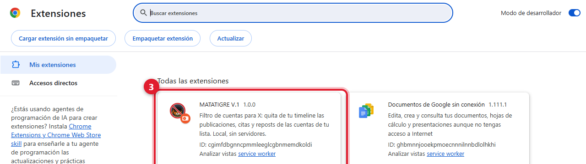
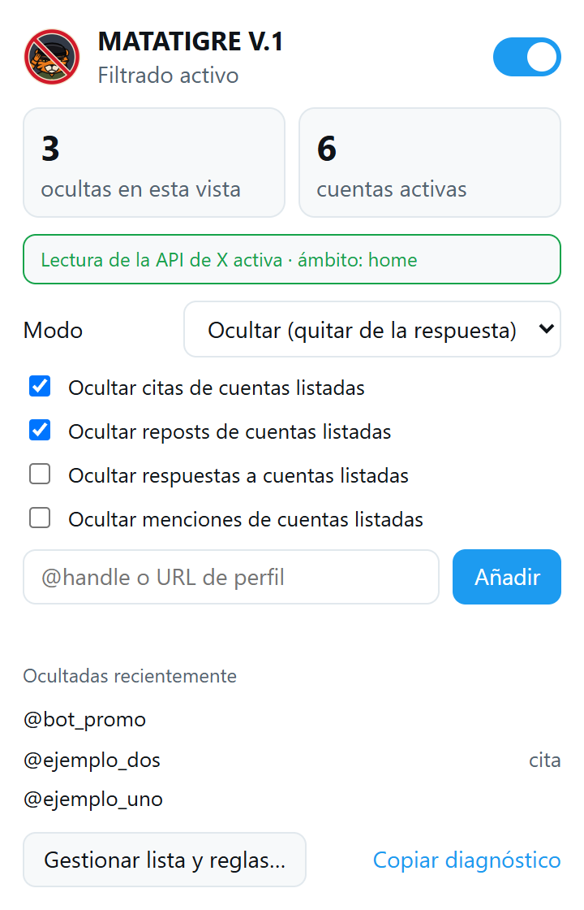

# Instalación

MATATIGRE V.1 no está en la Chrome Web Store: se instala como **extensión sin empaquetar** (modo de desarrollador).
Es el método habitual para extensiones de código abierto y tarda un minuto.

> Antes de instalar, lee el [descargo de responsabilidad](../DISCLAIMER.md). El uso es bajo tu propia responsabilidad.

## Requisitos

- Google Chrome **111 o superior**, o un navegador basado en Chromium (Microsoft Edge, Brave, Opera…).
- Una cuenta de X con sesión iniciada (la extensión actúa sobre `x.com` y `twitter.com`).

## Instalar (paso a paso)

### 1 · Descarga y descomprime

1. Abre [Releases](https://github.com/LarexDev/matatigre/releases) y descarga `matatigre-vX.Y.Z.zip`.
2. **Descomprímelo** en una carpeta permanente, por ejemplo `C:\Users\TuUsuario\Documentos\matatigre`.
   Chrome carga la extensión **desde esa carpeta**: si la mueves o la borras, la extensión deja de funcionar.
3. Dentro debe verse directamente el archivo `manifest.json` (junto a `background`, `popup`, `src`…).

*Alternativa para desarrolladores:* `git clone https://github.com/LarexDev/matatigre.git` y usa la carpeta `matatigre/extension`. No hace falta instalar nada con `npm`.

### 2 · Activa el modo de desarrollador

Abre `chrome://extensions` (en Edge: `edge://extensions`) y activa **Modo de desarrollador**, arriba a la derecha.

### 3 · Carga la extensión

Pulsa **Cargar extensión sin empaquetar** (en inglés, *Load unpacked*; el botón aparece al activar el modo de desarrollador)
y selecciona la carpeta que contiene `manifest.json`.

### 4 · Comprueba la instalación

Debe aparecer la tarjeta **MATATIGRE V.1** con el interruptor activado y sin errores.

> **Aviso normal de Chrome.** Al instalar una extensión desde una carpeta, Chrome puede mostrar *"Chrome no puede verificar de
> dónde proviene esta extensión"* o *"Revisa 1 extensión que podría no ser segura"*, y al abrir el navegador un aviso sobre
> extensiones en modo desarrollador. Es el comportamiento esperado para extensiones que no vienen de la Web Store; puedes
> cerrarlo. La extensión no hace peticiones de red: consulta [PRIVACY.md](../PRIVACY.md).

### 5 · Empieza a usarla

1. Abre [x.com](https://x.com) y **recarga con `F5`** (la extensión se engancha al cargar la página).
2. Fija el icono: puzzle de la barra de Chrome → alfiler junto a *MATATIGRE V.1*.
3. Pulsa el icono: arriba debe aparecer **"Lectura de la API de X activa"**.

## Comprobar que funciona

1. Añade una cuenta de prueba (popup → `@usuario` → *Añadir*).
2. Mira una búsqueda con sus publicaciones (`https://x.com/search?q=from%3Ausuario&f=live`): no deberían verse.

> En el **perfil** de una cuenta de tu lista se muestran sus publicaciones a propósito (opción *No filtrar dentro del
> perfil de la propia cuenta*, activa por defecto). Para probar, usa la búsqueda o tu Inicio.

## Actualizar

1. Descarga el ZIP de la nueva versión y descomprímelo **encima** de la carpeta anterior.
2. En `chrome://extensions`, pulsa el botón **Recargar** (flecha circular) de la tarjeta.
3. **Recarga x.com (F5)** en todas las pestañas abiertas.

Tu configuración (cuentas, reglas, ajustes) se conserva al actualizar. Si instalas desde **otra carpeta** como una
instalación nueva, la configuración empieza vacía: usa *Opciones → Datos → Exportar* antes y *Importar* después.

## Desinstalar

1. `chrome://extensions` → **Quitar** en la tarjeta de MATATIGRE V.1. Se borra su configuración.
2. Opcional: borra la carpeta descomprimida.
3. Opcional: la extensión deja una copia de la configuración en el almacenamiento local de x.com
   (clave `matatigre.cfg`). Para borrarla: en x.com, `F12` → *Application* → *Local storage* → `https://x.com` → elimina `matatigre.cfg`.

## Problemas frecuentes

| Síntoma | Qué hacer |
| --- | --- |
| No veo el botón **Cargar extensión sin empaquetar** | Activa el **Modo de desarrollador** en `chrome://extensions`. |
| "No se pudo cargar el manifiesto" | Elegiste la carpeta equivocada: debe contener `manifest.json` directamente. |
| El popup dice *"Aún sin datos de la API de X"* | **Recarga x.com (F5)**. La extensión se engancha al cargar la página. |
| El popup dice *"La página no responde"* | Recarga la pestaña de X; si persiste, recarga la extensión y la pestaña. |
| Añadí una cuenta y la sigo viendo | Mira si estás en **su perfil** (se muestra a propósito) o si la lista a la que pertenece está apagada (Opciones → Listas). Recarga la pestaña. |
| Veo citas o reposts de cuentas de mi lista | Revisa en *Opciones → Ajustes* que estén activas esas casillas. Si sigue, popup → **Copiar diagnóstico** y abre un [issue](https://github.com/LarexDev/matatigre/issues/new/choose). |
| Dejó de funcionar tras una actualización de X | X cambió su sitio. Abre un issue con el diagnóstico; puede requerir una actualización. |
| Chrome avisa de "extensiones en modo desarrollador" al abrir | Es un aviso normal para extensiones sin empaquetar; puedes cerrarlo. |

Si ninguna solución sirve: popup → **Copiar diagnóstico** (no incluye el contenido de tu timeline, solo contadores y la
estructura de la página) y pégalo en un [issue nuevo](https://github.com/LarexDev/matatigre/issues/new/choose).
