# Manual de uso

Todo lo que se configura se guarda **localmente** en tu navegador. Los cambios se aplican en caliente; lo que X ya
cargó se re-evalúa al instante y lo nuevo se filtra desde que llega.

## Primer uso: la bienvenida

Al instalar se abre una pantalla con las listas disponibles. Marca las que quieras y pulsa **Empezar**. Con **Ahora no** puedes añadirlas más tarde en *Opciones → Listas*.

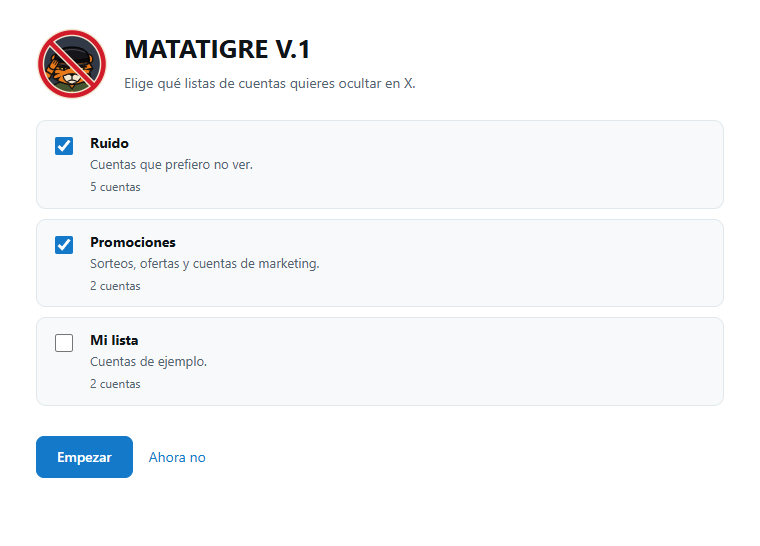

**Si vienes de la 1.x**, al actualizar se abre la misma pantalla: tus cuentas siguen funcionando y no se borra nada. Al elegir las listas, las cuentas que no hubieras editado
pasan a venir de ellas (y se actualizan solas); lo que añadiste o editaste a mano se queda como está.

## El popup (icono del tigre)

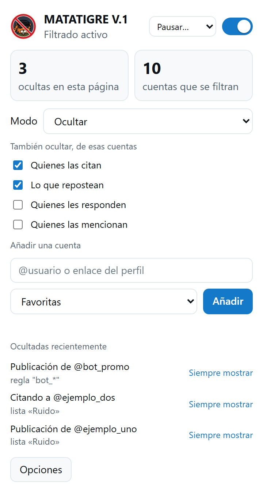

| Elemento | Qué hace |
| --- | --- |
| Interruptor | Activa o pausa todo el filtrado. |
| **Ocultas en esta vista** | Publicaciones filtradas desde que abriste esta sección de X. |
| **Cuentas activas** | Cuántas cuentas están filtrándose ahora, sumando tus cuentas y las de las listas suscritas (las de listas apagadas o desactivadas no cuentan). |
| Estado de la API | Verde: la extensión lee las respuestas de X (filtro en origen). Naranja: solo funciona el respaldo del DOM; recarga la pestaña. |
| **Modo** | El modo general: Ocultar · Colapsar · Resaltar (ver abajo). Cada lista puede tener el suyo. |
| Casillas rápidas | Citas, reposts, respuestas y menciones de cuentas de tu lista. |
| **Añadir una cuenta** | Escribe `@usuario` o el enlace de su perfil, elige una de **tus listas** y pulsa *Añadir*. Si aún no tienes ninguna lista propia, el popup te lleva a crearla. |
| *Añadir @usuario (perfil abierto)* | Aparece si estás en el perfil de una cuenta que aún no filtras; la añade a la lista elegida. |
| Ocultadas recientemente | Últimas cuentas filtradas y por qué (útil para detectar falsos positivos). |

## Clic derecho en X

Sobre cualquier **enlace a una cuenta o a una de sus publicaciones**, el menú del navegador tiene **MATATIGRE**: *Añadir a «lista»* (una entrada por cada una de **tus listas propias**; si no tienes ninguna, *Crear una lista propia…*) y *Siempre mostrar*. Funciona también donde no sale el icono: menciones, listados de personas, perfiles. Muestra el mismo aviso con *Deshacer*.

## Añadir desde X

Al pasar el ratón sobre una publicación de una cuenta que aún no filtras, aparece en la **esquina superior derecha** de la publicación, a la izquierda de los iconos de X, el **icono de MATATIGRE**. Al pulsarlo se abre una tarjeta:

- **Listas:** marca una o varias de **tus listas propias** (la última que usaste queda marcada). Aquí **no se crean listas**: se hace en *Opciones → Listas*. Si todavía no tienes ninguna, la tarjeta te ofrece crearla. *Añadir* se activa al elegir una.
- **Añadir:** guarda la cuenta en esas listas; su publicación desaparece y abajo aparece un aviso con **Deshacer** durante unos segundos.
- **Siempre mostrar:** en lugar de ocultarla, la deja en la lista de excepciones (nunca se oculta).

Las listas sincronizadas son de solo lectura, por eso no aparecen aquí. El icono no sale en cuentas que ya se filtran ni en las de «siempre mostrar», y se puede apagar en *Opciones → Ajustes*.

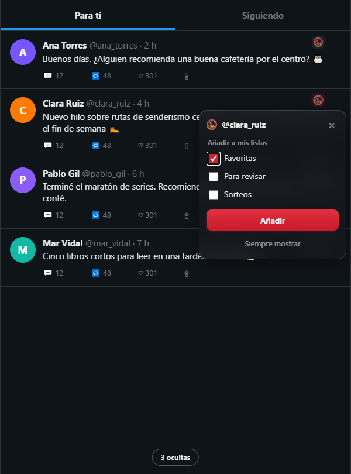

## Modos

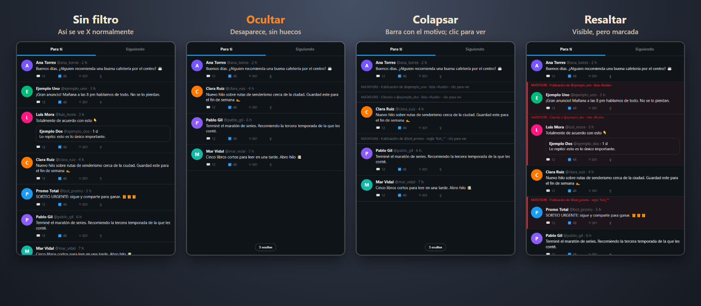

- **Ocultar:** la publicación se **elimina de la respuesta de X** antes de pintarse (y del DOM como respaldo). No quedan huecos. Es el más efectivo.
- **Colapsar:** la publicación se sustituye por una barra con el motivo; un clic la muestra.
- **Resaltar:** se deja visible con una marca roja y el motivo. Sirve para comprobar qué filtraría la extensión.

Atajos: `Alt+Shift+M` pausa o reanuda; `Alt+Shift+H` alterna entre Ocultar y Resaltar. Se reasignan en `chrome://extensions/shortcuts`.

## Página de opciones

Popup → **Opciones**

### Listas y cuentas

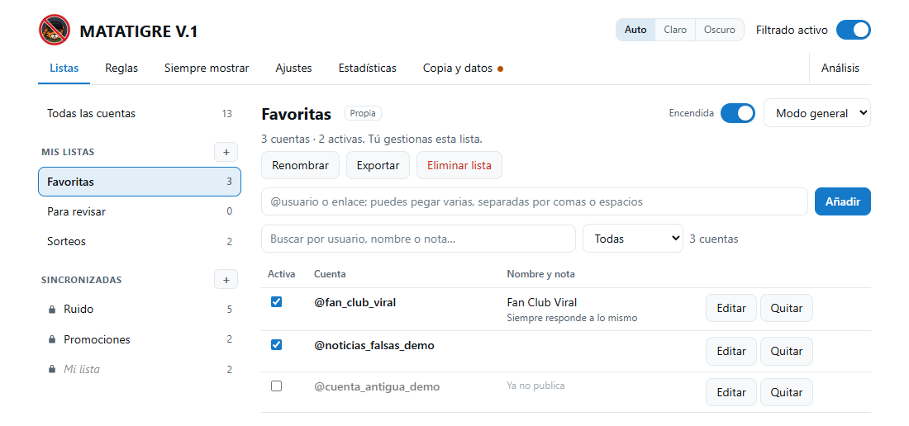

Toda la gestión está en una sola pestaña. A la izquierda, las listas en **tres grupos**; a la derecha, el detalle de la que elijas:

- **Todas las cuentas**: busca entre todas (propias y sincronizadas), filtra por lista o estado y mira a qué listas pertenece cada una.
- **Mis listas**: las creas y gestionas tú.
- **Sincronizadas** (con candado): vienen de fuera y se actualizan solas.

**Mis listas** (propias). Pulsa **+** para crear una (el nombre no puede repetirse). Dentro de una lista puedes **añadir cuentas** (pega varias a la vez, separadas por comas o espacios), **editar** nombre, nota y listas de cada cuenta, **quitar** una cuenta de la lista, **renombrar**, **exportar** (archivo con el mismo formato de las listas sincronizadas) y **eliminar**. Casi todo se puede **deshacer** durante unos segundos. Una cuenta propia siempre pertenece a alguna lista: si la quitas de la última, se elimina.

**Sincronizadas.** Su contenido **no se puede modificar**: la lista se actualiza sola cada 12 horas (si falla se sigue usando la última copia) y reemplaza lo anterior. Lo que sí puedes hacer sin tocar el original:

- **Encenderla o apagarla** y elegir su **modo** (ver abajo).
- **Omitir cuentas solo para ti** con la casilla de cada cuenta (aparecen como *omitidas*; *Restaurar* las devuelve).
- **Copiar a una lista mía**: copia las cuentas que se ven (según la búsqueda y el filtro) a una lista propia, nueva o existente, para quedártelas y editarlas. La sincronizada no cambia.
- **Actualizar** al momento o **Dejar de seguir**.

**Añadir una lista sincronizada.** Pulsa **+** junto a *Sincronizadas*: ves las del catálogo que aún no sigues, o pegas la dirección (https) de una lista publicada por otra persona; formato en [LISTAS.md](LISTAS.md).

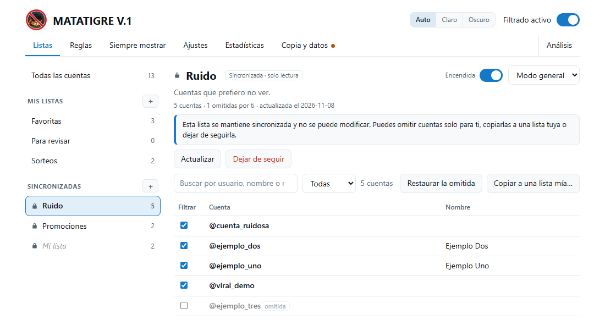

Una cuenta con varias listas se filtra si **alguna** de ellas está activa. Las cuentas propias sin ninguna lista (de versiones anteriores) aparecen marcadas *sin lista*: se filtran siempre y puedes asignarlas a una lista con un clic.

**Un modo por lista.** Cada lista tiene un selector: *Modo general* (el de *Ajustes*), *Ocultar*, *Colapsar* o *Resaltar*. Así, por ejemplo, una lista puede ocultarse del todo y otra solo marcarse.
Si una publicación coincide por varios motivos (una cuenta en dos listas, o su autor en una y la cuenta citada en otra), **gana el modo más restrictivo**: ocultar, luego colapsar, luego resaltar. Las reglas usan el modo general.

**Reconocer cuentas por identificador.** La extensión aprende sola el identificador de las cuentas de tus listas cuando las ve en X. Así una cuenta que **cambia de nombre de usuario** se sigue filtrando, y si su nombre pasa a **otra persona**, esa persona no se oculta por error. (Las listas pueden traer ya el identificador; ver [LISTAS.md](LISTAS.md).)

**Apariencia.** Arriba a la derecha eliges *Auto* (la del sistema), *Claro* u *Oscuro*; se aplica al popup, a las opciones y a la bienvenida.

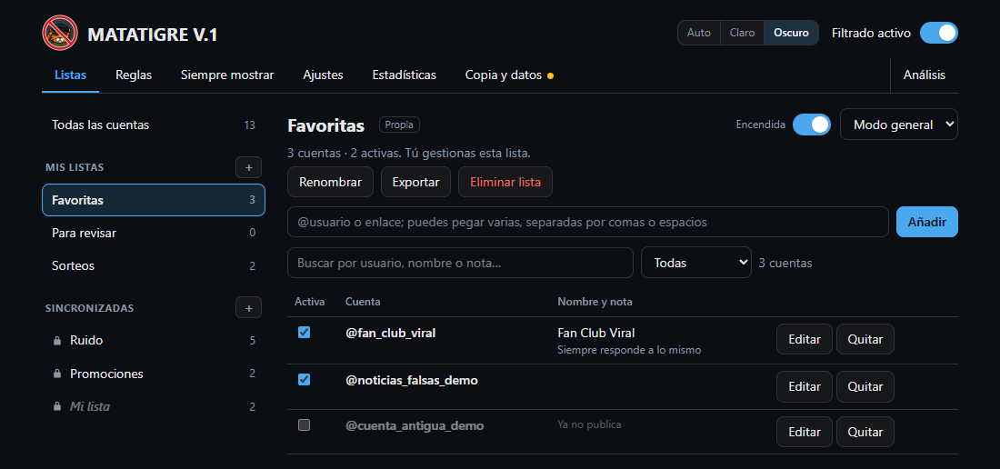

### Reglas

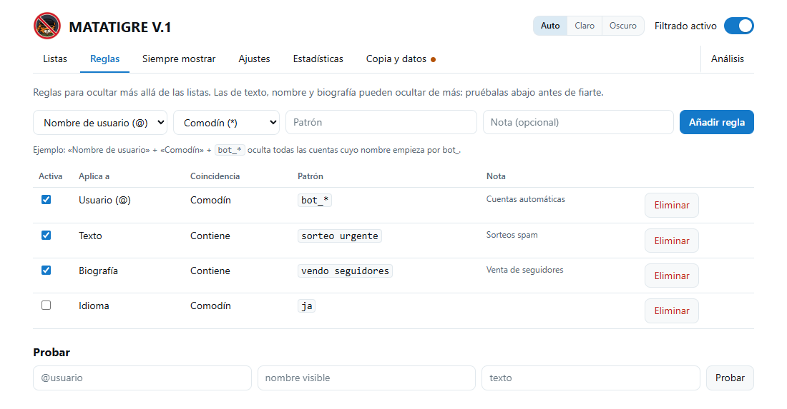
Reglas adicionales a la lista de cuentas. Cada una tiene un **tipo**:

| Aplica a | Ejemplo |
| --- | --- |
| Handle | `bot_*` (comodín) |
| Nombre visible | contiene `sorteo` |
| Biografía | contiene `vendo seguidores` |
| Texto de la publicación | regex `\bgratis\b` |
| Idioma | `ja` |

Y una **coincidencia**: comodín (`*` = cualquier texto), "contiene" (sin distinguir mayúsculas ni tildes) o expresión regular.
Usa el **probador** al final de la pestaña antes de fiarte de una regla. Las reglas de texto, nombre y biografía son
las más propensas a ocultar de más.

### Siempre mostrar
Cuentas que **nunca** se ocultan, aunque coincidan con una lista, una regla o un repost.

### Ajustes

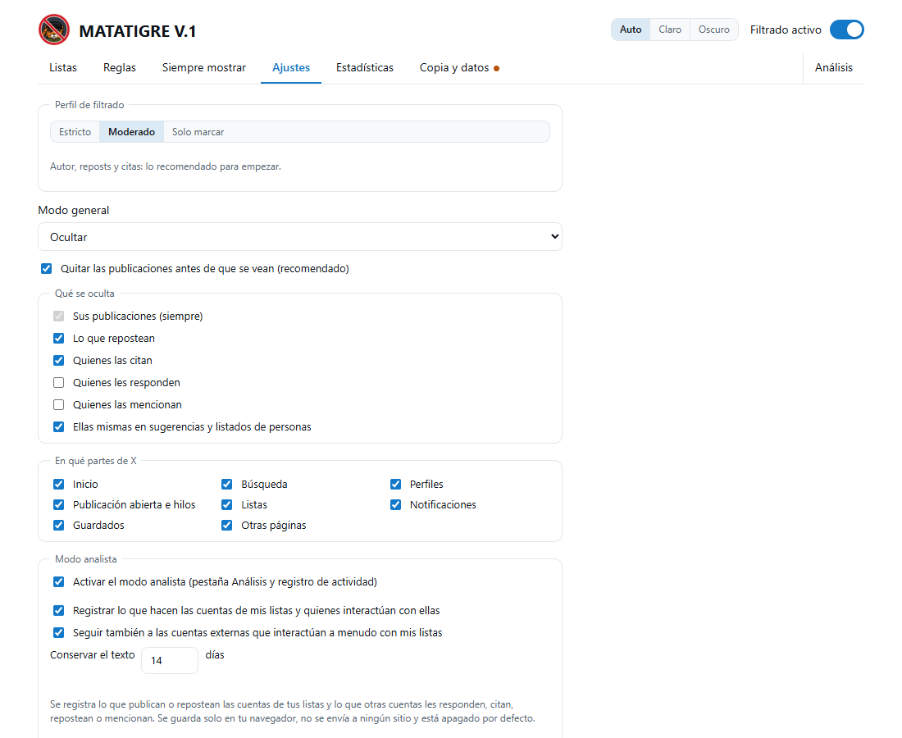
- **Modo general** y **Filtro en origen** (quitar de la respuesta de X; recomendado). El modo general rige para las reglas y para las listas que no tengan modo propio.
- **Qué cuenta como coincidencia:** autor (siempre), reposts, citas, respuestas, menciones, sugerencias de personas.
- **En qué partes de X:** un interruptor por sección de X (Inicio, Búsqueda, Perfiles, Publicación abierta e hilos, Listas, Notificaciones, Guardados, Otras).
- **Cuándo no ocultar:** no ocultar el perfil de la propia cuenta; no ocultar la publicación que abres directamente.
- **Contador:** una pequeña etiqueta abajo en la página con el número de publicaciones ocultas en esa vista (solo informa; se puede apagar).

Valores por defecto: autor, reposts y citas **sí**; respuestas y menciones **no**.

### Modo analista (opcional)

En *Ajustes → Modo analista* se activa el análisis. **Mientras está apagado** no hay pestaña *Análisis* ni se guarda nada. Al activarlo se enciende el
**registro local**: la extensión **guarda en tu equipo** lo que publican o repostean las cuentas de tus listas **y** lo que otras cuentas les responden, citan, repostean o mencionan (identificador, hora, contadores, enlaces, hashtags, menciones y el texto durante los días que indiques). **No guarda nada más**: las cuentas que no tocan a tus listas no se registran.
Se registra también lo que el modo *Ocultar* te esconde, porque es justo lo que interesa analizar. No se envía a ningún sitio. En *Copia y datos* ves cuánto hay guardado y puedes **Borrar registro**. Si pausas el registro en *Ajustes*, el análisis sigue disponible con lo ya guardado (la pestaña ofrece reanudarlo). Detalles en [PRIVACY.md](../PRIVACY.md#registro-local-opcional-apagado-por-defecto).

### Análisis

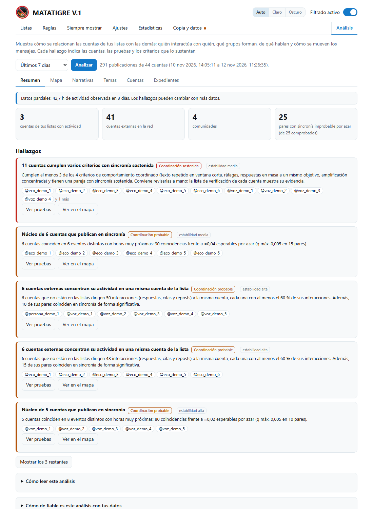

Al abrir la pestaña el análisis se calcula solo sobre el periodo elegido (*Analizar* lo repite). Seis secciones:

- **Resumen:** cuántos datos hay detrás (*escasos*, *parciales* o *amplios*, según las horas y los días de actividad observada), cifras clave y los **hallazgos**, cada uno con su nivel, las cuentas, las pruebas y **cuántas coincidencias se observaron frente a cuántas serían de esperar por azar**. Al final, *Cómo de fiable es este análisis con tus datos*: una prueba de control que pasa el mismo detector por datos con las horas barajadas (ahí no debe salir nada) y la distribución de los valores p.
- **Mapa:** un mapa de **burbujas**: cada cuenta es una burbuja (su tamaño es la atención que recibe), y las comunidades forman **racimos** del mismo color con su nombre. Un aro grueso marca las cuentas de tus listas. Por defecto solo se dibujan la sincronía (en rojo) y las relaciones más fuertes; al **señalar una cuenta** se ven las suyas, o marca *Todas*. Pulsa una burbuja para su ficha y un racimo para la de la comunidad; los botones con el nombre de cada comunidad la resaltan. Arrastra para mover y **Ctrl + rueda** para acercar; busca una cuenta por nombre; cambia a *Red de relaciones* para verlas por cercanía en lugar de por comunidad; *Imagen* lo descarga. Todos los controles están dentro del propio cuadro del mapa: buscar, acercar, alejar, ajustar, restablecer la vista, **pantalla completa** (Esc para salir), imagen, capas y leyenda. Debajo, las **comunidades** y la **actividad simultánea entre comunidades**: comunidades distintas que, aunque hablen de cosas distintas, suben su actividad en las mismas franjas de 10 minutos más de lo esperable (se descartan los momentos en que casi todo el mundo se activa a la vez).
- **Narrativas:** contenidos que comparten varias cuentas, con la curva de cuentas que van entrando y su concentración. Los **hechos externos** que anotes en un expediente (una noticia, un fallo, una declaración) salen sobre la curva y, en el detalle, a qué distancia empieza la narrativa. Que una cosa venga después de otra no prueba que la cause.
- **Temas:** defines un tema con una lista de palabras (`reforma, pension*, salud mental`) y ves cuánto se habla de él, en qué comunidades, cuándo y quién entró primero. Sin inteligencia artificial: se ve por qué palabra cuenta cada publicación. También se sugieren las palabras que varias comunidades usan a la vez.
- **Cuentas:** las **cuentas externas que interactúan con tus listas**, como *afín* (amplifica, como cualquier persona convencida: no indica coordinación) o *sincronizada* (además coincide en el tiempo con otras cuentas más de lo esperable); las más relevantes; la comparación entre listas con los mismos umbrales; y el detalle de eventos y señales.
- **Expedientes:** reúnen pruebas, hechos externos y notas de un caso, con informe y paquete verificable.

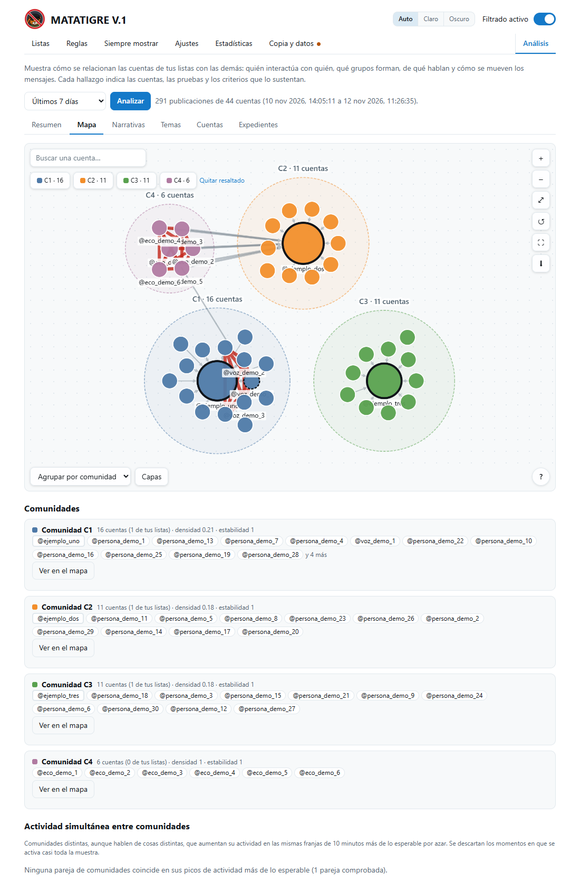

Cualquier cuenta, relación, hallazgo o narrativa abre un **panel lateral** con sus criterios, pruebas y explicaciones alternativas (se cierra con *Esc*). El análisis describe **patrones compatibles con comportamiento coordinado en una muestra parcial**: no dice quién hay detrás, cuántas personas son ni con qué intención, y la etiqueta, si procede, la pones tú.

### Pausa y perfiles

- **Pausar un tiempo:** el selector *Pausar…* del popup apaga el filtrado 10 minutos, 1 hora o 12 horas y lo reanuda solo (el popup dice hasta qué hora). Si lo enciendes antes con el interruptor, se cancela la pausa.
- **Perfiles:** en *Ajustes* (arriba) eliges *Estricto*, *Moderado* o *Solo marcar* de un clic; si después cambias algo, aparece «Personalizado».

### Estadísticas

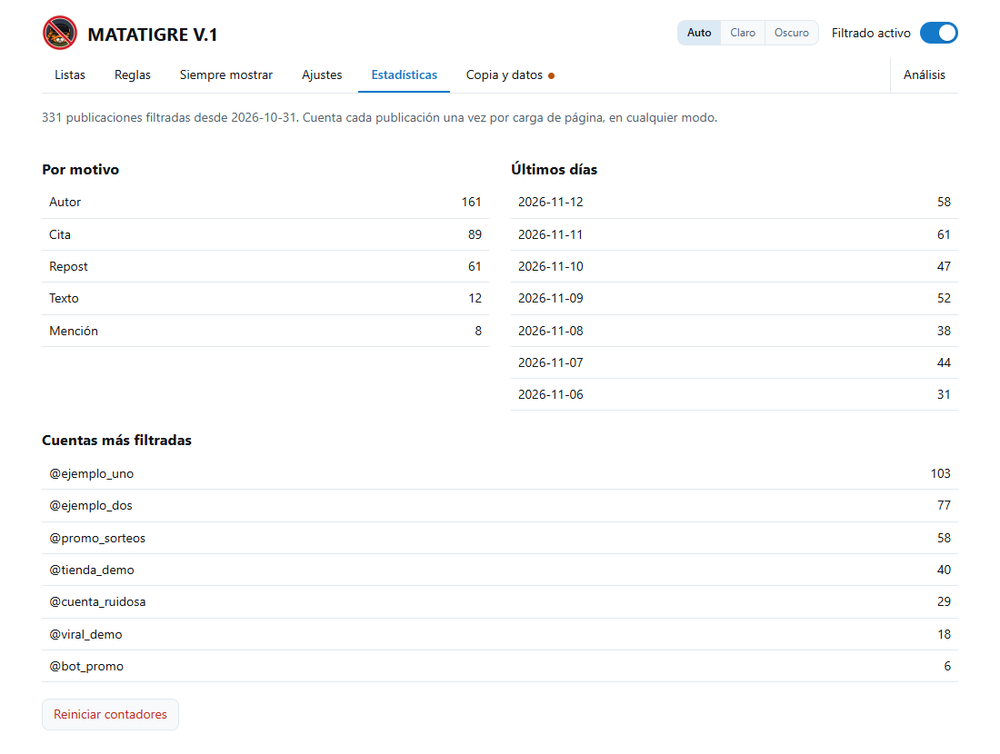
Total filtrado, por motivo, por día (últimos 10) y cuentas más filtradas. Se pueden reiniciar.

### Datos
- **Copia de seguridad:** cuántas listas sincronizadas sigues y cuántas listas y cuentas propias tienes, con *Exportar* e *Importar*, y cuándo hiciste la última. Si tienes listas propias y pasaron 30 días (o nunca exportaste), la pestaña *Datos* muestra un punto de aviso. Los expedientes se guardan aparte: se exportan desde cada uno.
- **Registro de actividad**, **Soporte** y **Empezar de cero**, en bloques separados.
- **Exportar:** descarga un JSON con tu configuración (copia de seguridad): tus listas y cuentas propias, reglas, excepciones («Siempre mostrar»), ajustes, cuentas omitidas y tus suscripciones. No incluye el contenido de las listas descargadas.
- **Importar:** lee un JSON y **suma** sus listas, cuentas, reglas y excepciones a lo que ya tienes; los ajustes del archivo sí reemplazan los actuales. Los datos se validan antes de guardarse.
  Si el archivo sigue listas del catálogo, te pregunta antes de descargarlas; las suscripciones por URL nunca se importan. Formato: [LISTAS.md](LISTAS.md).
- **Copiar informe para soporte:** copia al portapapeles un informe técnico (sin el contenido de tu timeline) para adjuntarlo a un issue. Abre antes x.com.
- **Restablecer:** borra todo (cuentas, suscripciones, reglas y ajustes) y vuelve a la pantalla de bienvenida.

## Dónde se aplica cada cosa

| Situación | Comportamiento |
| --- | --- |
| Estás en el perfil de una cuenta de tu lista | Se muestran sus publicaciones (opción activa por defecto). Las de otras cuentas de tu lista siguen ocultas. |
| Abres una publicación concreta (`/usuario/status/…`) | Se muestra esa publicación (opción activa por defecto); las demás del hilo se filtran. |
| Una sección está apagada en *En qué partes de X* | No se filtra nada en esa sección. |
| La cuenta está en «Siempre mostrar» | Nunca se oculta. |

## Consejos

- Empieza en modo **Resaltar** para ver qué se filtraría antes de pasar a Ocultar.
- Si algo se oculta por error, mira *Ocultadas recientemente* en el popup y añade la cuenta a «Siempre mostrar».
- Después de cambios grandes, recarga la pestaña de X para que lo nuevo se cargue ya filtrado.
